# Hardening Implementation

## Overview

This document records the security hardening measures implemented on the Ubuntu 26.04.1 LTS assessment system following the findings identified during the initial Lynis audit.

The objective of this phase is to implement selected security improvements, reduce the number of outstanding recommendations, and increase the overall Hardening Index while maintaining system stability and functionality.

---

## Implementation Scope

The measures implemented in this phase were selected from the findings classified as Quick Wins during the assessment process.

These recommendations were prioritized because they provide immediate security benefits with minimal operational impact.

---

## Implemented Measures

### IMPL-001 – Needrestart Installation

#### Related Finding

```text
DEB-0831
Install needrestart
```

#### Objective

Identify services using outdated libraries after package upgrades and determine when service restarts are required.

#### Implementation

```bash
sudo apt install needrestart -y
```

#### Validation

The package was successfully installed and configured.

Needrestart is now available to identify services requiring a restart after software updates and package upgrades.

#### Evidence

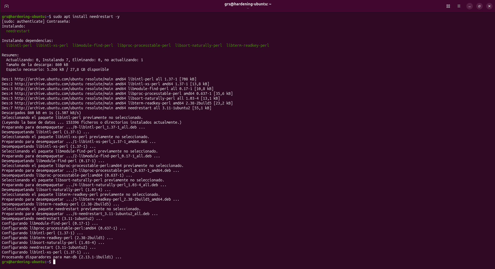

---

### IMPL-002 – Fail2ban Installation

#### Related Finding

```text
DEB-0880
Install fail2ban
```

#### Objective

Automatically detect and block repeated authentication failures.

#### Implementation

```bash
sudo apt install fail2ban -y
```

#### Validation

Fail2ban was successfully installed and the service started automatically after installation.

The service was verified as active and enabled through systemd.

#### Evidence

##### Evidence 01 – Fail2ban Installation

The package was successfully installed together with the required dependencies.

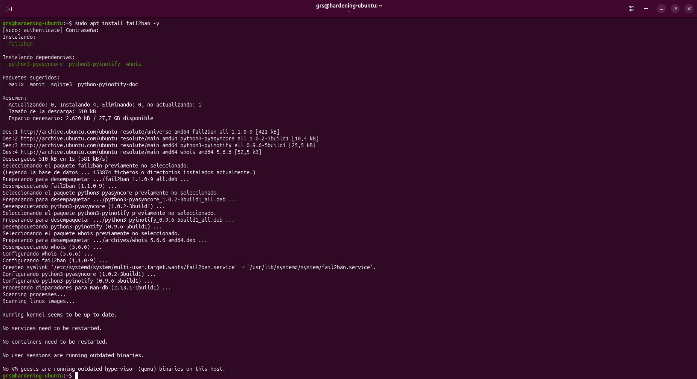

##### Evidence 02 – Service Status Verification

The Fail2ban service was verified as active and running after installation.

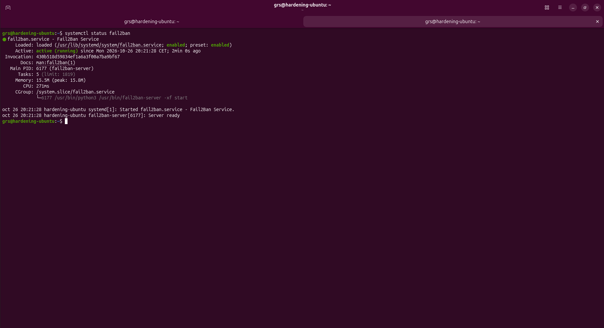

---

### IMPL-003 – Firewall Configuration

#### Related Finding

```text
FIRE-4590
Configure a firewall/packet filter
```

#### Objective

Control incoming and outgoing network traffic according to defined security rules.

#### Implementation

```bash
sudo ufw default deny incoming
sudo ufw default allow outgoing
sudo ufw enable
```

#### Validation

UFW was configured with a default deny policy for inbound traffic and a default allow policy for outbound traffic.

The firewall was successfully enabled and verified using the UFW status command.

#### Evidence

##### Evidence 01 – Baseline Firewall Status

The firewall was installed but inactive before configuration.

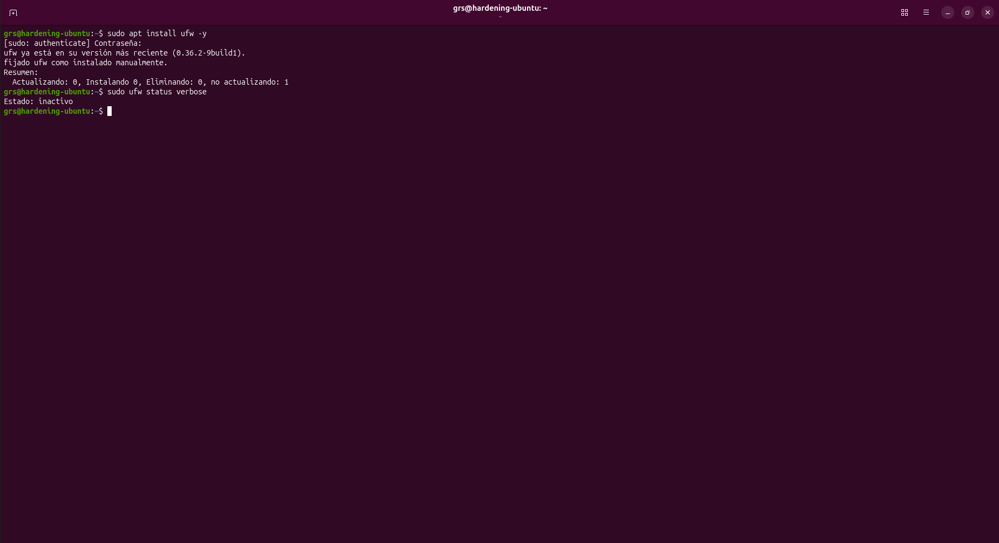

##### Evidence 02 – Firewall Configuration and Activation

The firewall was configured and enabled using secure default policies.

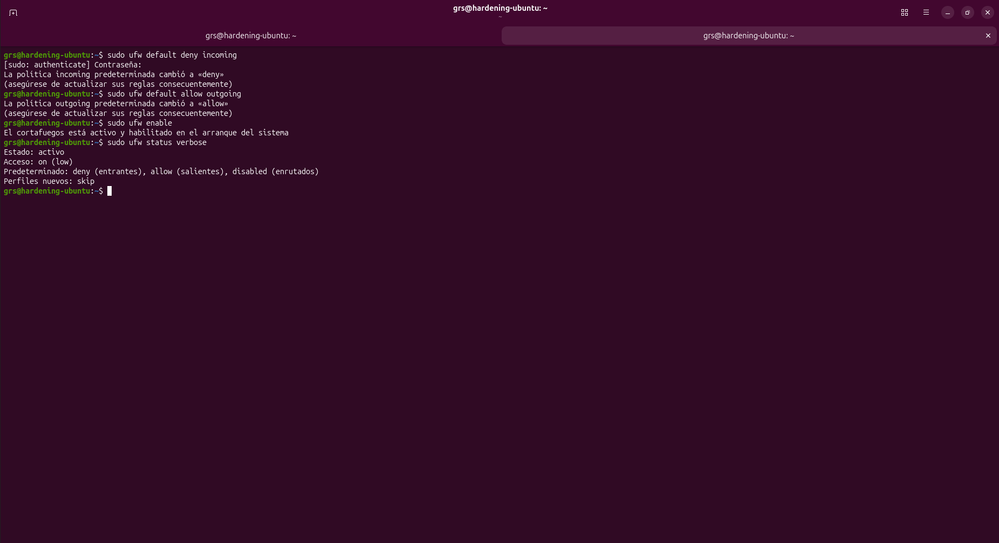

---

### IMPL-004 – Process Accounting

#### Related Finding

```text
ACCT-9622
Enable process accounting
```

#### Objective

Record executed commands and process activity to improve accountability and forensic capabilities.

#### Implementation

```bash
sudo apt install acct -y
```

#### Validation

Process accounting was successfully installed and enabled.

The accounting service was verified through systemd and confirmed as active after installation.

#### Evidence

##### Evidence 01 – Process Accounting Installation and Validation

The accounting package was installed successfully and the service was verified after deployment.

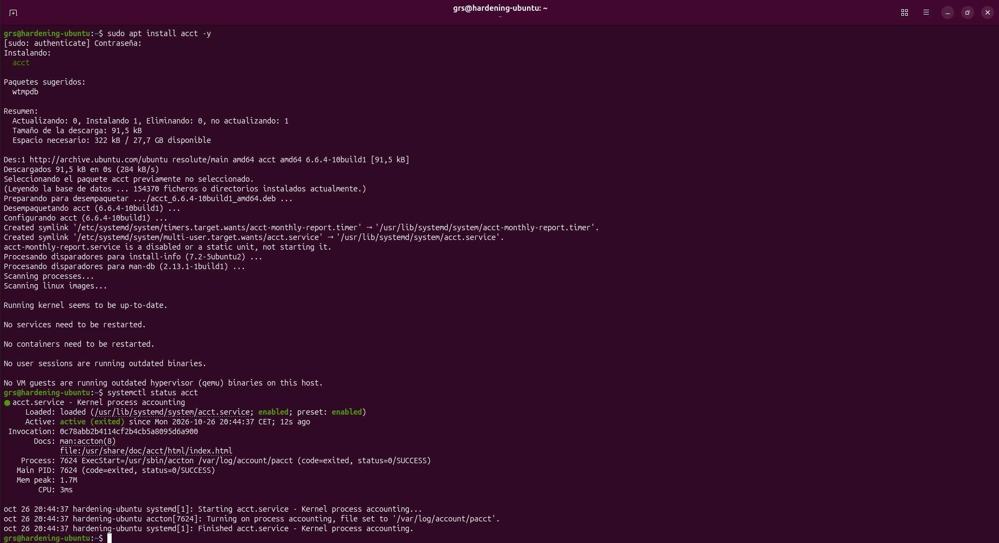

---

### IMPL-005 – Auditd Enablement

#### Related Finding

```text
ACCT-9628
Enable auditd to collect audit information
```

#### Objective

Enable Linux auditing capabilities and event collection for security monitoring and investigation purposes.

#### Implementation

```bash
sudo apt install auditd -y
```

#### Validation

Auditd was successfully installed and enabled.

The service was verified through systemd and confirmed as active and running after installation.

#### Evidence

##### Evidence 01 – Auditd Installation

The auditd package and required dependencies were successfully installed.

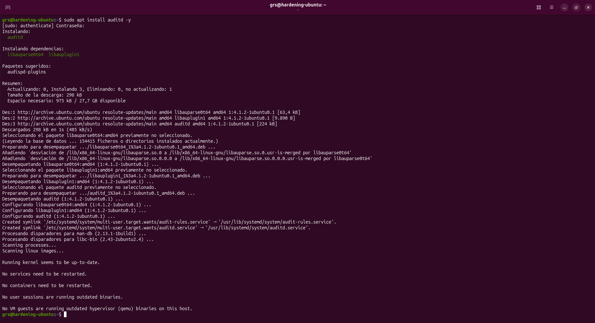

##### Evidence 02 – Auditd Service Validation

The auditd service was verified after installation and confirmed as active and running.

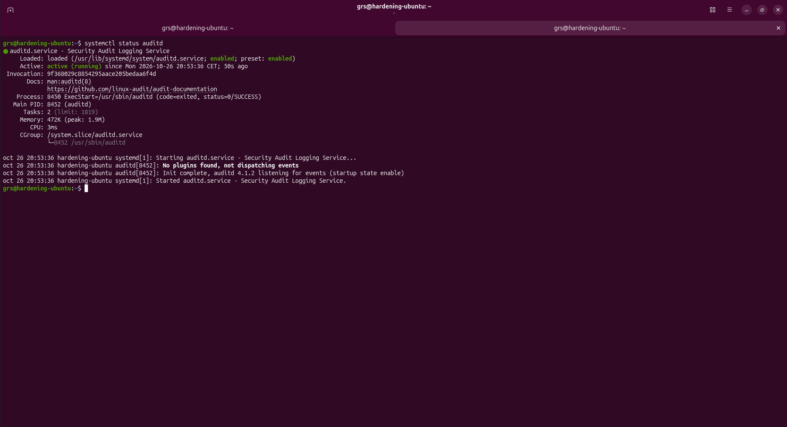

---

### IMPL-006 – File Integrity Monitoring

#### Related Finding

```text
FINT-4350
Install a file integrity tool
```

#### Objective

Monitor critical system files and detect unauthorized modifications.

#### Implementation

```bash
sudo apt install aide -y
sudo aideinit
```

#### Validation

AIDE was successfully installed and an initial integrity database was generated.

The initialization process created the baseline integrity database files required for future integrity verification activities.

#### Evidence

##### Evidence 01 – AIDE Installation

The AIDE package and its required dependencies were successfully installed.

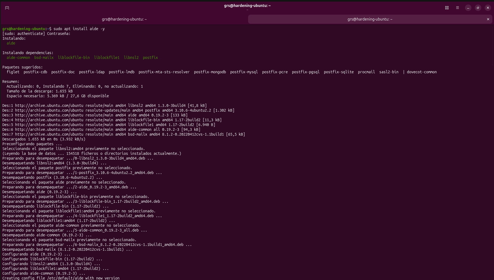

##### Evidence 02 – Postfix Configuration

During the installation process, AIDE requested Postfix configuration options required for notification capabilities.

The laboratory environment was configured without mail services.

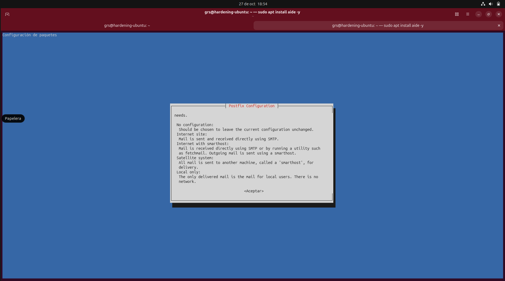


##### Evidence 03 – Integrity Database Initialization

The initial integrity baseline was created using the AIDE initialization process.

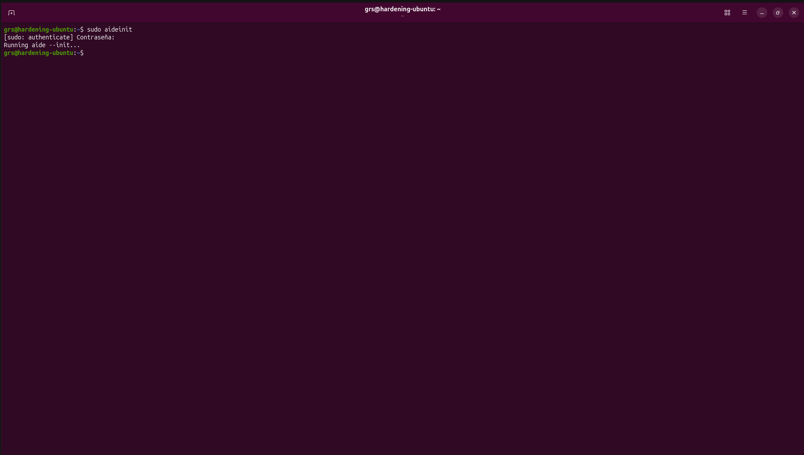

##### Evidence 04 – Integrity Database Verification

The generated integrity database files were verified after initialization.

The presence of both `aide.db` and `aide.db.new` confirms successful baseline database creation.

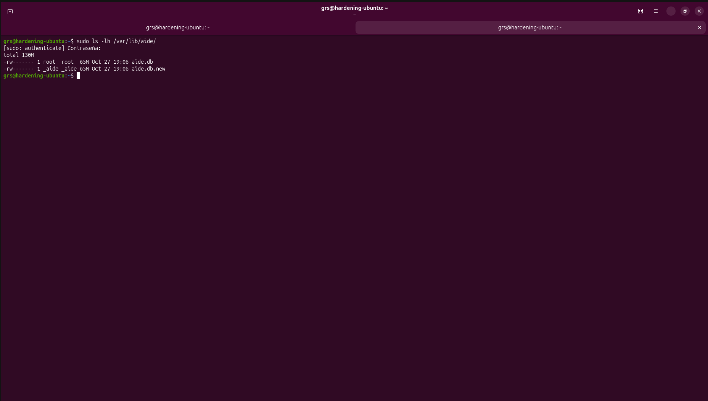

---

### IMPL-007 – Package Verification Utility

#### Related Finding

```text
PKGS-7370
Install debsums
```

#### Objective

Provide package integrity verification based on package checksums.

#### Implementation

```bash
sudo apt install debsums -y
```

#### Validation

Debsums was successfully installed and verified after deployment.

The utility is now available to verify package file integrity against known package checksums.

#### Evidence

##### Evidence 01 – Debsums Installation

The debsums package and its required dependencies were successfully installed.

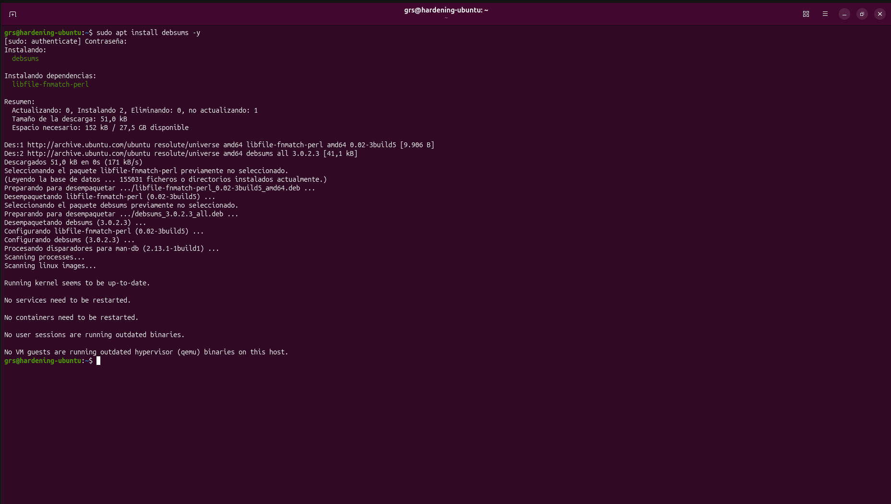

##### Evidence 02 – Debsums Validation

The utility was verified after installation and confirmed operational.

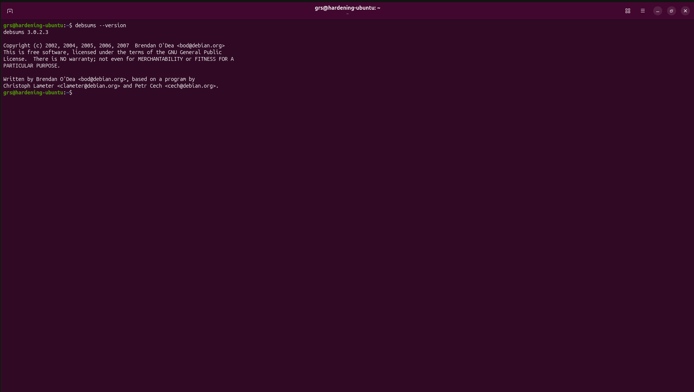

---

### IMPL-008 – Package Version Review Utility

#### Related Finding

```text
PKGS-7394
Install apt-show-versions
```

#### Objective

Improve package management visibility and patch tracking.

#### Implementation

```bash
sudo apt install apt-show-versions -y
```

#### Validation

The apt-show-versions utility was successfully installed and verified after deployment.

The tool is now available to review package versions and identify package upgrade status information.

#### Evidence

##### Evidence 01 – Apt-show-versions Installation

The apt-show-versions package and its required dependencies were successfully installed.

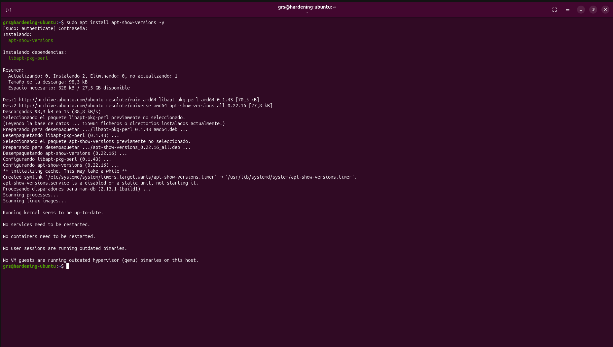

##### Evidence 02 – Apt-show-versions Validation

The utility was verified after installation and confirmed operational.

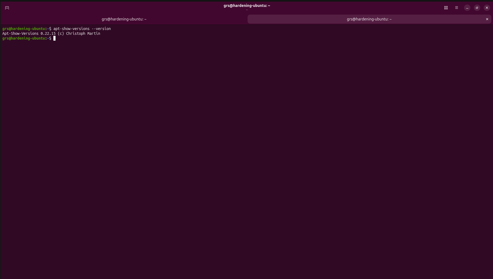


---

## Implementation Summary

| ID | Related Finding | Measure | Status |
|-----------|-----------|-----------|-----------|
| IMPL-001 | DEB-0831 | Needrestart | Implemented |
| IMPL-002 | DEB-0880 | Fail2ban | Implemented |
| IMPL-003 | FIRE-4590 | UFW Firewall | Implemented |
| IMPL-004 | ACCT-9622 | Process Accounting | Implemented |
| IMPL-005 | ACCT-9628 | Auditd | Implemented |
| IMPL-006 | FINT-4350 | AIDE | Implemented |
| IMPL-007 | PKGS-7370 | Debsums | Implemented |
| IMPL-008 | PKGS-7394 | Apt-show-versions | Implemented |

---

## Expected Outcome

The implementation phase is expected to:

- Improve the Hardening Index.
- Increase auditing and monitoring capabilities.
- Improve system visibility and accountability.
- Add file integrity monitoring.
- Introduce basic intrusion prevention capabilities.
- Provide a baseline host firewall configuration.

Results will be validated during the post-hardening assessment phase.