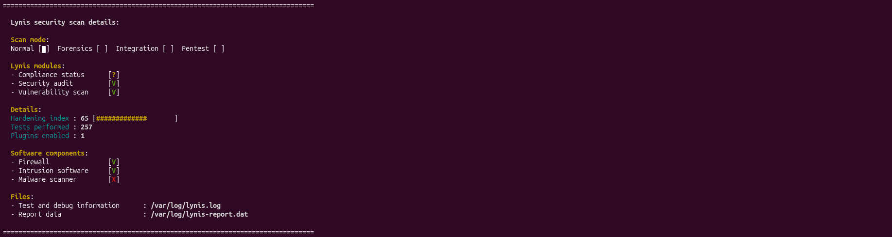

# Hardening Validation and Results

## Overview

This document records the validation phase performed after implementing the selected hardening measures identified during the initial Lynis assessment.

The objective of this phase is to verify the effectiveness of the implemented controls, evaluate their impact on the system security posture, and compare the final results against the baseline assessment.

---

## Validation Objectives

- Verify successful implementation of the selected hardening measures.
- Compare the system security posture before and after remediation.
- Measure improvements through a follow-up Lynis assessment.
- Validate that implemented controls operate correctly.
- Document the security improvements achieved during the project.

---

## Validation Methodology

After completing all Quick Win implementations, a new Lynis audit was executed using the same methodology applied during the baseline assessment.

### Validation Audit

```bash
sudo lynis audit system
```

### Generated Artifacts

The final assessment artifacts were preserved for comparison purposes.

| File | Description |
|-----------|-----------|
| artifacts/lynis-final.log | Complete post-hardening Lynis audit log |
| artifacts/lynis-report-final.dat | Structured Lynis report generated after remediation |

---

## Implemented Controls

The following hardening measures were successfully implemented during the remediation phase.

| ID | Control | Status |
|-----------|-----------|-----------|
| IMPL-001 | Needrestart | Implemented |
| IMPL-002 | Fail2ban | Implemented |
| IMPL-003 | UFW Firewall | Implemented |
| IMPL-004 | Process Accounting | Implemented |
| IMPL-005 | Auditd | Implemented |
| IMPL-006 | AIDE | Implemented |
| IMPL-007 | Debsums | Implemented |
| IMPL-008 | Apt-show-versions | Implemented |

---

## Assessment Comparison

### Security Assessment Results

| Metric | Baseline | Final | Difference |
|-----------|-----------|-----------|-----------|
| Hardening Index | 63 | 65 | +2 |
| Tests Performed | 249 | 257 | +8 |
| Plugins Enabled | 1 | 1 | No Change |

### Security Components

| Component | Baseline | Final |
|-----------|-----------|-----------|
| Firewall | Not Detected | Detected |
| Intrusion Software | Not Detected | Detected |
| Malware Scanner | Not Detected | Not Detected |

---

## Validation Results

The validation audit confirmed that several security controls introduced during the implementation phase are now detected by Lynis.

The most significant improvements observed during the reassessment were:

- Firewall detection through UFW.
- Intrusion prevention capability through Fail2ban.
- Additional auditing and monitoring capabilities.
- File integrity monitoring deployment.
- Improved package verification and management tooling.

The implemented controls contributed to an increase in the overall Hardening Index from 63 to 65.

---

## Evidence

### Evidence 01 – Final Audit Results

Screenshot of the final Lynis assessment after implementing the selected hardening measures.

- Hardening Index: 65
- Firewall: Detected
- Intrusion Software: Detected
- Malware Scanner: Not Detected



### Evidence 02 – Validation Artifacts

Files generated during the final assessment:

- [artifacts/lynis-final.log](artifacts/lynis-final.log)
- [artifacts/lynis-report-final.dat](artifacts/lynis-report-final.dat)

These artifacts provide the technical evidence required to validate the final assessment results and compare them against the baseline.

---

## Lessons Learned

Several recommendations identified by Lynis can be implemented with minimal impact while providing measurable improvements to the system security posture.

The assessment-first approach used during this project allowed recommendations to be reviewed and prioritized before implementation, reducing the risk of unnecessary or disruptive changes.

The use of baseline and post-remediation assessments provided an effective way to measure the impact of the implemented controls and validate the hardening process.

---

## Final Conclusions

The project successfully established a security baseline, identified hardening opportunities, implemented selected security controls, and validated the resulting improvements.

The implemented measures increased the Hardening Index from 63 to 65 while introducing additional defensive, auditing, monitoring, and integrity verification capabilities.

The remaining recommendations identified by Lynis may be evaluated and implemented in future iterations depending on operational requirements and laboratory objectives.