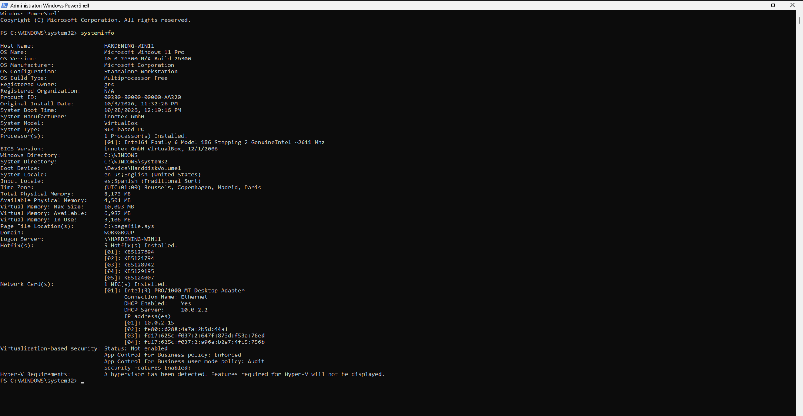
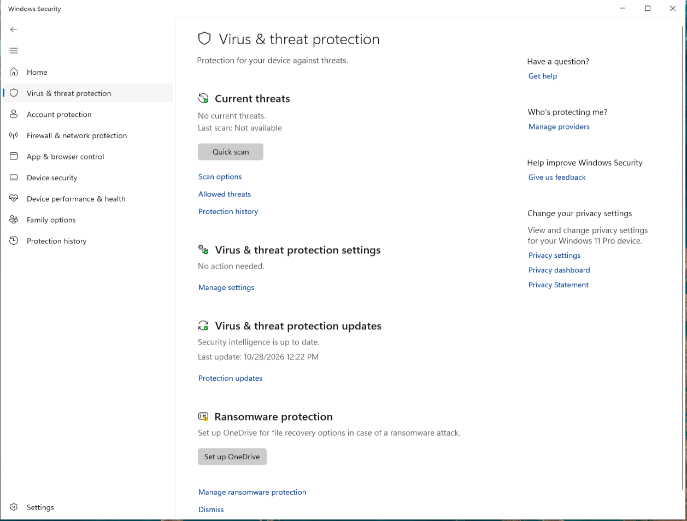
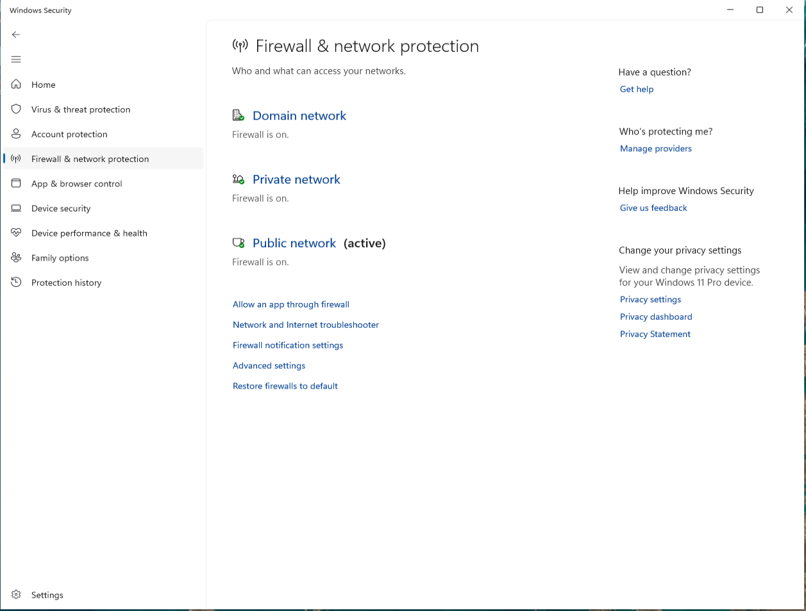
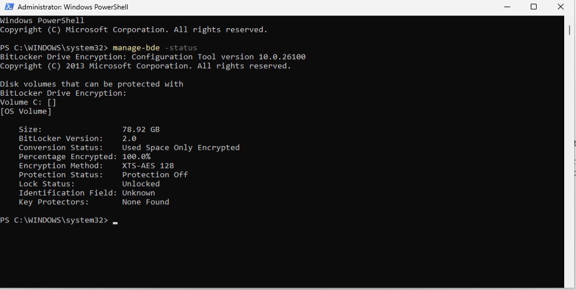
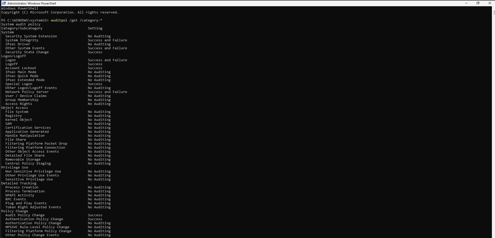
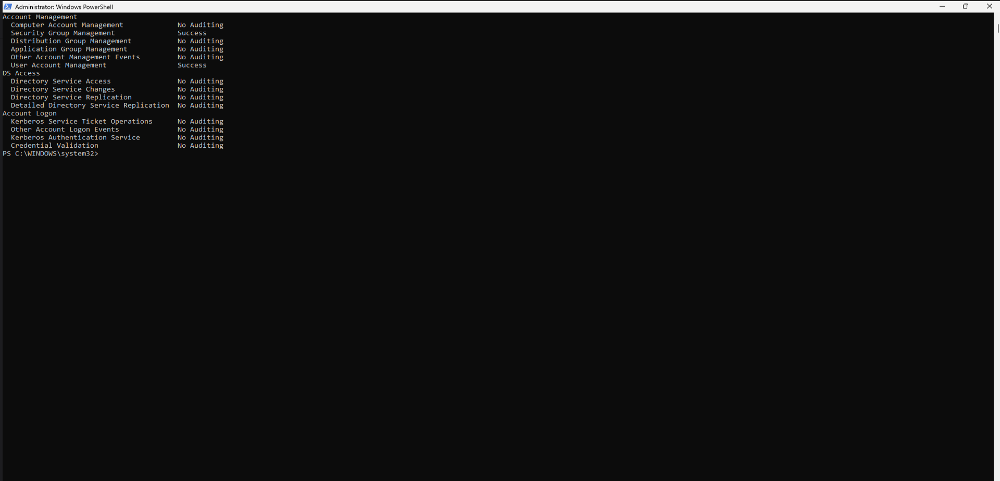
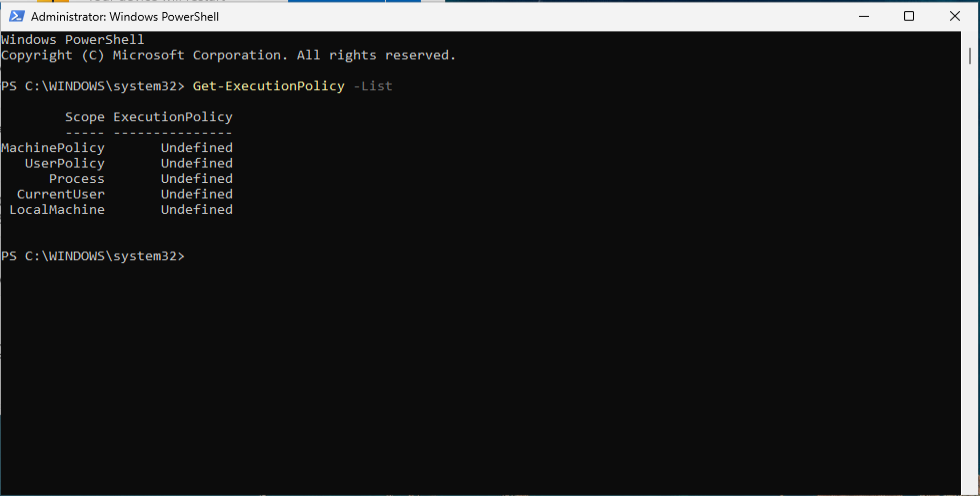
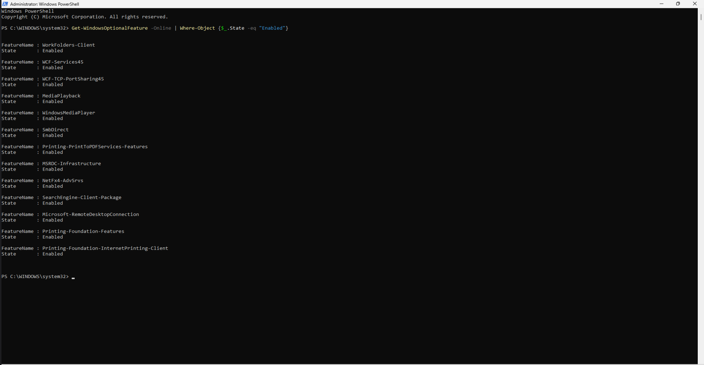

# Initial Security Assessment and Baseline

## Overview

This document records the initial security assessment performed on a clean Windows 11 Pro installation.

The objective of this phase is to establish a security baseline, identify areas for improvement, and classify the findings obtained during the assessment before any hardening measures are applied.

---

## Assessment Objectives

- Establish a security baseline for the system.
- Identify security configuration weaknesses.
- Review native Windows security controls.
- Detect opportunities for security hardening.
- Classify findings according to risk and impact.
- Define a reference point for future comparisons.

---

## Scope

The assessment was conducted on a Windows 11 Pro virtual machine created specifically for hardening and validation activities.

### Assessed System

| Item | Value |
|-----------|-----------|
| Operating System | Windows 11 Pro 26H2 |
| Build | 26300.9457 |
| Platform | Oracle VirtualBox 7.2.6 |
| Virtual Machine Name | hardening-win11 |
| Memory | 8 GB |
| CPU | 2 vCPU |
| Disk | 80 GB Dynamic VDI |
| TPM | Enabled (2.0) |
| Secure Boot | Enabled |
| Assessment Status | Baseline |

---

## Methodology

The assessment follows a manual review approach using native Windows administration tools and security controls.

The objective is to evaluate the current configuration before implementing any security improvements.

### Assessment Areas

The following areas will be reviewed:

- System information.
- Windows Security configuration.
- Windows Defender status.
- Firewall configuration.
- User Account Control (UAC).
- BitLocker configuration.
- Audit policy configuration.
- PowerShell security settings.
- Local security policies.
- Windows optional features.
- Network security controls.

---

## Initial Assessment

The baseline assessment is performed before applying any hardening measures.

All findings identified during this phase will be classified and evaluated before implementation.

---

## Generated Artifacts

Assessment artifacts generated during this phase will be stored as evidence.

Artifacts will be added progressively as information is collected during the assessment process.

Additional artifacts may be added as the assessment progresses.

---

## Baseline Results

### Executive Summary

| Metric | Result |
|-----------|-----------|
| Operating System | Windows 11 Pro |
| Version | 10.0.26300 Build 26300 |
| Hostname | HARDENING-WIN11 |
| Virtualization Platform | Oracle VirtualBox |
| Microsoft Defender Status | Operational |
| Firewall Status | Enabled |
| BitLocker Status | Encrypted (Protection Disabled)|
| UAC Configuration | Default Configuration |
| Audit Policies | Partially Configured |
| PowerShell Execution Policy | Undefined |
| Windows Optional Features | Reviewed |

### Observations

The baseline system information was collected using the native Windows `systeminfo` command.

The assessment confirmed that the operating system is Windows 11 Pro running Build 26300 on a virtualized Oracle VirtualBox platform with Secure Boot and TPM support enabled.

No hardening measures have been applied at this stage of the assessment.

Microsoft Defender was detected as the active endpoint protection solution.

The platform reported no active threats and no pending security actions. Security intelligence definitions were up to date at the time of the assessment.

No malware scans had been executed prior to the assessment and ransomware protection remained unconfigured.

Windows Defender Firewall was enabled across all network profiles at the time of the assessment.

The Domain, Private, and Public profiles were configured and active, providing baseline network protection without requiring additional configuration.

BitLocker was detected on the operating system volume.

The volume was fully encrypted using XTS-AES 128-bit encryption. However, protection was disabled and no key protectors were configured at the time of the assessment.

Although disk encryption had been applied, the absence of active protection mechanisms limits the security benefits typically provided by BitLocker.

User Account Control (UAC) was enabled using the default Windows 11 configuration.

The system was configured to notify users when applications attempt to make changes to the operating system while suppressing notifications for user-initiated changes to Windows settings.

This configuration provides a balance between security and usability, although stricter configurations are available.

Audit policies were reviewed using the native Windows audit policy configuration tool.

Several security-relevant auditing categories were enabled by default, including logon events, account management, system integrity, and policy changes.

However, multiple categories commonly used for security monitoring and forensic investigations were not configured for auditing, including process creation, object access, privilege use, and detailed tracking.

PowerShell execution policies were reviewed to determine whether script execution restrictions had been configured.

No execution policies were defined at the MachinePolicy, UserPolicy, Process, CurrentUser, or LocalMachine scopes.

The system therefore relies on the default PowerShell execution behavior and does not currently enforce additional script execution restrictions.

Windows optional features were reviewed to identify legacy or unnecessary components that could increase the system attack surface.

No legacy SMBv1 components were detected among the enabled Windows features.

The review identified several enabled components, including Remote Desktop Client, Work Folders Client, WCF services, SMB Direct, and .NET Framework advanced services.

No high-risk optional features were identified during the baseline assessment.

---

## Detected Security Controls

| Control | Status |
|-----------|-----------|
| Microsoft Defender | Enabled |
| Windows Firewall | Enabled |
| BitLocker | Encrypted (Protection Disabled) |
| UAC | Enabled (Default Configuration) |
| Audit Policies | Partially Configured |
| PowerShell Execution Policy | Undefined |
| Optional Features Review | Completed |


---

## Findings Summary

The baseline assessment identified a Windows 11 Pro installation with multiple security controls already enabled by default.

Several security features, including Microsoft Defender, Windows Defender Firewall, User Account Control (UAC), Secure Boot, and TPM 2.0, were present and operational at the time of the assessment.

The review also identified a number of opportunities for improvement in areas related to disk protection, auditing capabilities, PowerShell security controls, and security monitoring visibility.

The most relevant findings identified during the assessment include:

- BitLocker encryption present but operating without active protection.
- Audit policies only partially configured.
- PowerShell execution policies left undefined.
- Ransomware protection not configured.
- Multiple monitoring and auditing capabilities available but not fully utilized.

Positive findings identified during the assessment include:

- Microsoft Defender operational and up to date.
- Windows Defender Firewall enabled across all network profiles.
- User Account Control enabled.
- Secure Boot enabled.
- TPM 2.0 enabled.
- SMBv1 not present among enabled Windows optional features.

The identified findings will be classified according to impact, complexity, and applicability before selecting the hardening measures that will be implemented during the remediation phase.

---

## Findings Classification

### Quick Wins

The following findings can be remediated with minimal operational impact and are expected to provide an immediate security benefit.

| ID | Finding | Risk | Action |
|-----------|-----------|-----------|-----------|
| WIN-001 | Enable BitLocker protection | Medium | Implement |
| WIN-002 | Configure ransomware protection | Medium | Implement |
| WIN-003 | Define PowerShell execution policy | Medium | Implement |
| WIN-004 | Expand audit policy coverage | Medium | Implement |

### Requires Analysis

The following findings require additional review before implementation due to their potential impact on usability, administration, or system operations.

| ID | Finding | Risk | Action |
|-----------|-----------|-----------|-----------|
| WIN-005 | Advanced PowerShell logging configuration | Medium | Review |
| WIN-006 | Advanced audit policy tuning | Medium | Review |
| WIN-007 | Credential protection enhancements | Medium | Review |
| WIN-008 | Remote access configuration review | Low | Review |

### Not Applicable

The following findings were reviewed and determined to be outside the scope of the current laboratory environment.

| ID | Finding | Reason |
|-----------|-----------|-----------|
| WIN-009 | SMBv1 remediation | SMBv1 is not enabled on the system |
---

## Evidence

### Evidence 01 – System Information

System information was collected using the native Windows `systeminfo` command to establish the baseline configuration of the assessed system.

```powershell
systeminfo
```

The collected information confirms the operating system version, build number, hostname, virtual machine configuration, and baseline operating environment used during the assessment.



### Evidence 02 – Microsoft Defender Status

Microsoft Defender was reviewed to determine the baseline endpoint protection status of the system.

The assessment confirmed that Microsoft Defender was operational, reporting no active threats and no pending security actions.

The security intelligence database was up to date at the time of the assessment.



### Evidence 03 – Windows Firewall Status

The Windows Defender Firewall configuration was reviewed as part of the baseline assessment.

The assessment confirmed that firewall protection was enabled across the Domain, Private, and Public network profiles.

No warnings or configuration issues were identified at the time of the assessment.



### Evidence 04 – BitLocker Status

BitLocker encryption was reviewed as part of the baseline assessment.

The operating system volume was found to be fully encrypted using XTS-AES 128-bit encryption. However, protection was disabled and no key protectors were configured.

```powershell
manage-bde -status
```



### Evidence 05 – User Account Control Configuration

User Account Control (UAC) settings were reviewed as part of the baseline assessment.

The system was configured using the default Windows 11 notification level, requiring user notification when applications attempt to make changes to the operating system.

This configuration provides baseline protection against unauthorized administrative changes while maintaining usability.


### Evidence 06 – Audit Policy Configuration

Windows audit policies were reviewed using the native audit policy management utility.

```powershell
auditpol /get /category:*
```

The assessment confirmed that several security-related auditing categories were enabled by default. However, multiple auditing areas commonly used for security monitoring and forensic investigations remained disabled.





### Evidence 07 – PowerShell Execution Policy

PowerShell execution policies were reviewed to determine whether script execution restrictions had been configured.

```powershell
Get-ExecutionPolicy -List
```

The assessment confirmed that no execution policies were explicitly configured across any scope.

This indicates that the system relies on the default PowerShell execution behavior.



### Evidence 08 – Windows Optional Features

Windows optional features were reviewed to identify legacy or unnecessary components that could increase the system attack surface.

```powershell
Get-WindowsOptionalFeature -Online | Where-Object {$_.State -eq "Enabled"}
```

The assessment confirmed that SMBv1 was not enabled and no high-risk legacy components were identified among the active optional features.



---

## Initial Conclusions

The baseline assessment identified a Windows 11 Pro installation with several security controls already enabled by default.

Microsoft Defender was operational and up to date, providing baseline endpoint protection without requiring additional configuration. Windows Defender Firewall was also enabled across all network profiles, ensuring initial network protection was in place.

The assessment confirmed the presence of BitLocker encryption on the operating system volume. However, protection was disabled and no key protectors were configured, reducing the effectiveness of the encryption mechanism.

User Account Control (UAC) was enabled using the default Windows 11 configuration, providing a balance between security and usability. While this configuration offers protection against unauthorized administrative changes, stricter notification settings remain available.

Audit policy review revealed that several security-relevant categories were enabled by default, including authentication, account management, and policy change events. However, multiple categories commonly used for security monitoring and forensic investigations remained disabled, limiting system visibility.

PowerShell execution policies were found to be undefined across all available scopes, indicating that no additional restrictions had been configured beyond the default PowerShell behavior.

The review of Windows optional features did not identify any high-risk legacy components. In particular, SMBv1 was not present among the enabled features, reducing exposure to a commonly targeted legacy protocol.

Overall, the system presents a reasonably secure default configuration. However, several opportunities for improvement were identified in areas such as BitLocker protection, audit policy coverage, PowerShell security controls, and system monitoring capabilities.

The next phase of the project will focus on analyzing and classifying the identified findings to determine which hardening measures should be implemented and which are not applicable within the scope of this laboratory environment.