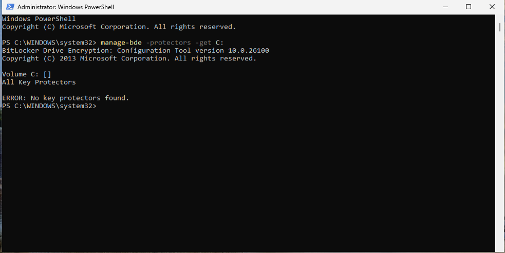
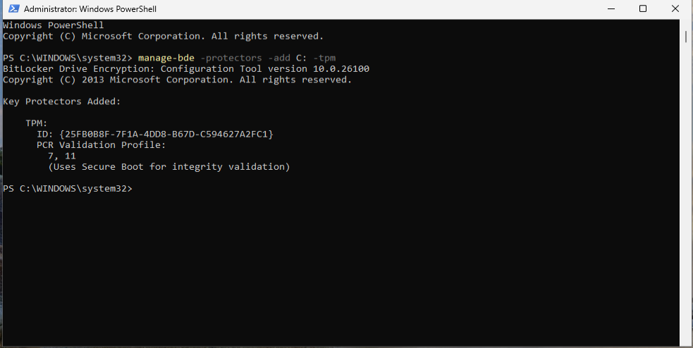
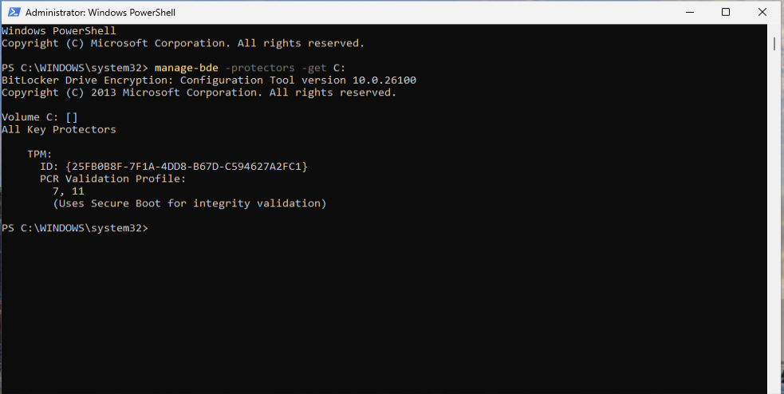

# Hardening Implementation

## Overview

This document records the security hardening measures implemented on the Windows 11 Pro assessment system following the findings identified during the initial security assessment.

The objective of this phase is to implement selected security improvements, reduce identified security gaps, and improve the overall security posture of the operating system while maintaining system stability and usability.

---

## Implementation Scope

The measures implemented in this phase were selected from the findings classified as Quick Wins during the assessment process.

These recommendations were prioritized because they provide immediate security benefits with minimal operational impact.

---

### IMPL-001 – BitLocker Protection Enablement

#### Related Finding

```text
WIN-001
Enable BitLocker protection
```

#### Objective

Enable BitLocker protection mechanisms and configure appropriate key protectors to ensure that disk encryption provides effective protection against unauthorized access.

#### Implementation

A TPM-based key protector was added to the operating system volume.

```powershell
manage-bde -protectors -add C: -tpm
```

#### Validation

The existing BitLocker encryption configuration was reviewed before implementation and no key protectors were configured on the operating system volume.

After implementation, a TPM protector was successfully added and associated with the encrypted volume.

The TPM protector uses Secure Boot integrity validation through PCR values 7 and 11, providing protection for the encrypted operating system volume.

#### Evidence

##### Evidence 01 – Initial BitLocker Configuration

The encrypted operating system volume was reviewed before implementation.

No BitLocker protectors were configured at the time of the assessment.

```powershell
manage-bde -protectors -get C:
```



##### Evidence 02 – TPM Protector Creation

A TPM-based BitLocker protector was successfully created.

```powershell
manage-bde -protectors -add C: -tpm
```



##### Evidence 03 – Protector Verification

The BitLocker configuration was reviewed after implementation.

The TPM protector was successfully associated with the operating system volume.

```powershell
manage-bde -protectors -get C:
```



---

### IMPL-002 – Ransomware Protection Configuration

#### Related Finding

```text
WIN-002
Configure ransomware protection
```

#### Objective

Enable and configure ransomware protection features available within Microsoft Defender to improve protection against unauthorized file modification and encryption attempts.

#### Implementation

To be completed.

#### Validation

To be completed.

#### Evidence

To be added.

---

### IMPL-003 – PowerShell Execution Policy Configuration

#### Related Finding

```text
WIN-003
Define PowerShell execution policy
```

#### Objective

Define an appropriate PowerShell execution policy to restrict script execution while preserving administrative functionality.

#### Implementation

To be completed.

#### Validation

To be completed.

#### Evidence

To be added.

---

### IMPL-004 – Audit Policy Enhancement

#### Related Finding

```text
WIN-004
Expand audit policy coverage
```

#### Objective

Increase auditing visibility by enabling additional audit categories relevant to security monitoring, forensic investigations, and system accountability.

#### Implementation

To be completed.

#### Validation

To be completed.

#### Evidence

To be added.

---

## Implementation Summary

| ID | Related Finding | Measure | Status |
|-----------|-----------|-----------|-----------|
| IMPL-001 | WIN-001 | BitLocker Protection | Implemented |
| IMPL-002 | WIN-002 | Ransomware Protection | Pending |
| IMPL-003 | WIN-003 | PowerShell Execution Policy | Pending |
| IMPL-004 | WIN-004 | Audit Policy Enhancement | Pending |

---

## Expected Outcome

The implementation phase is expected to:

- Improve BitLocker protection effectiveness.
- Strengthen protection against ransomware activity.
- Reduce unrestricted PowerShell execution.
- Improve security monitoring and auditing visibility.
- Strengthen the overall Windows security posture.

Results will be validated during the post-hardening assessment phase.