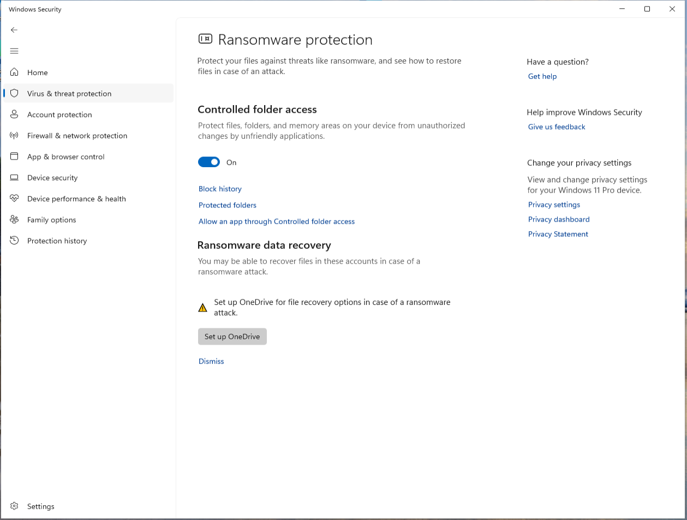
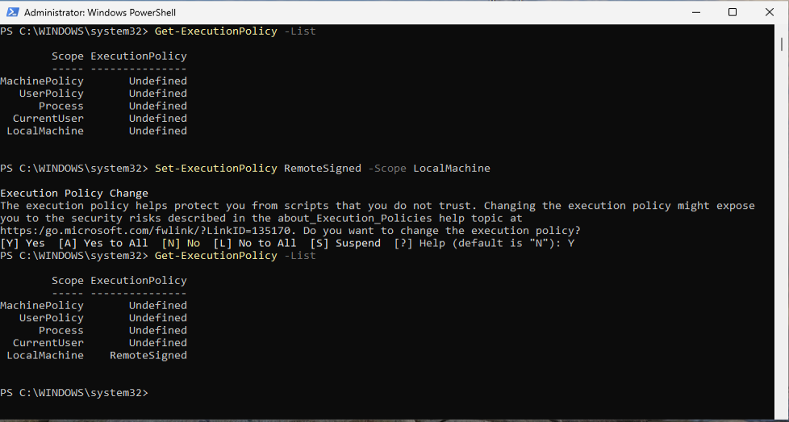
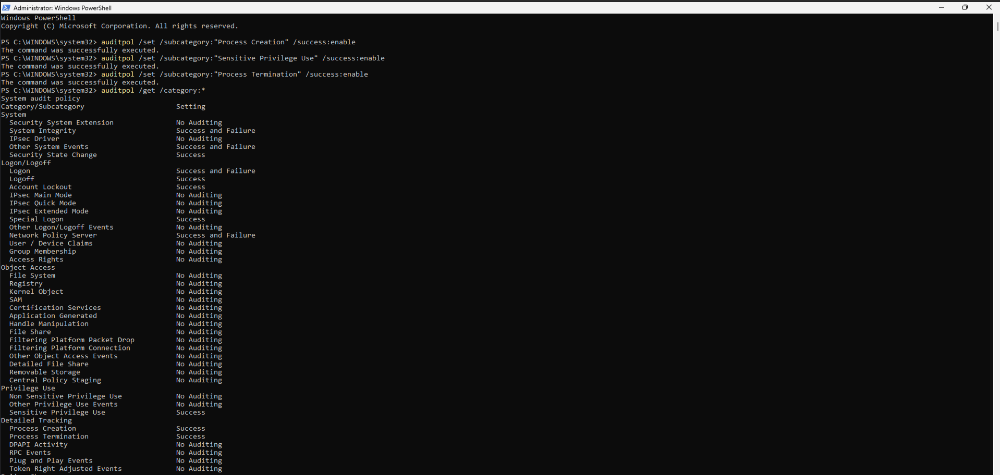
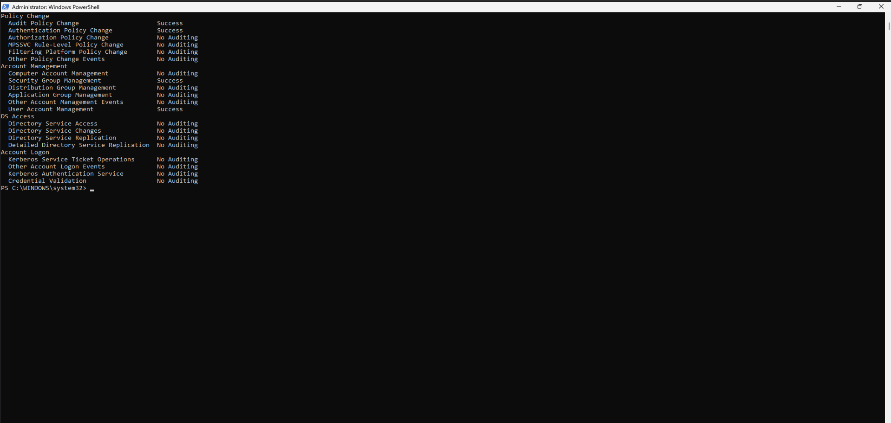

# Hardening Validation and Results

## Overview

This document records the validation phase performed after implementing the selected hardening measures identified during the initial Windows 11 security assessment.

The objective of this phase is to verify the effectiveness of the implemented controls, evaluate their impact on the system security posture, and compare the final results against the baseline assessment.

---

## Validation Objectives

- Verify successful implementation of the selected hardening measures.
- Compare the system security posture before and after remediation.
- Validate that implemented controls operate correctly.
- Confirm that identified findings have been addressed.
- Document the security improvements achieved during the project.

---

## Validation Methodology

After completing all Quick Win implementations, the security controls previously reviewed during the baseline assessment were reassessed using the same methodology.

### Validation Areas

The following controls were reviewed during validation:

- BitLocker protection.
- Microsoft Defender ransomware protection.
- PowerShell execution policy.
- Windows audit policy configuration.

### Generated Artifacts

Validation artifacts generated during this phase will be stored as evidence.

Additional artifacts may be added if required.

---

## Implemented Controls

The following hardening measures were successfully implemented during the remediation phase.

| ID | Control | Status |
|-----------|-----------|-----------|
| IMPL-001 | BitLocker Protection | Implemented |
| IMPL-002 | Ransomware Protection | Implemented |
| IMPL-003 | PowerShell Execution Policy | Implemented |
| IMPL-004 | Audit Policy Enhancement | Implemented |

---

## Assessment Comparison

### Security Controls

| Control | Baseline | Final |
|-----------|-----------|-----------|
| BitLocker Protection | Protection Disabled | TPM Protection Enabled |
| Controlled Folder Access | Disabled | Enabled |
| PowerShell Execution Policy | Undefined | RemoteSigned |
| Process Creation Auditing | Disabled | Enabled |
| Process Termination Auditing | Disabled | Enabled |
| Sensitive Privilege Use Auditing | Disabled | Enabled |

### Security Features

| Feature | Baseline | Final |
|-----------|-----------|-----------|
| Microsoft Defender | Enabled | Enabled |
| Windows Firewall | Enabled | Enabled |
| TPM 2.0 | Enabled | Enabled |
| Secure Boot | Enabled | Enabled |
| UAC | Enabled (Default) | Enabled (Default) |

---

## Validation Results

The validation phase confirmed that all selected hardening measures were successfully implemented.

The most significant improvements observed after remediation were:

- BitLocker protection enabled through a TPM-based protector.
- Controlled Folder Access enabled within Microsoft Defender.
- PowerShell execution policy configured using the RemoteSigned policy.
- Additional audit policies enabled for process creation, process termination, and sensitive privilege use.

The implemented controls improved the security posture of the operating system while maintaining system usability and administrative functionality.

---

## Evidence

### Evidence 01 – BitLocker Protection Validation

The operating system volume was reviewed after implementation to verify that BitLocker protection was correctly configured.

A TPM-based protector was successfully associated with the encrypted operating system volume.

### Evidence 02 – Ransomware Protection Validation

Microsoft Defender ransomware protection was reviewed after implementation.

Controlled Folder Access was successfully enabled and configured.

### Evidence 03 – PowerShell Execution Policy Validation

The PowerShell execution policy configuration was reviewed after implementation.

The LocalMachine scope was successfully configured using the RemoteSigned policy.

### Evidence 04 – Audit Policy Validation

The Windows audit policy configuration was reviewed after implementation.

Additional auditing categories for Process Creation, Process Termination, and Sensitive Privilege Use were successfully enabled.

---

## Lessons Learned

Several meaningful security improvements can be implemented using native Windows security controls without requiring additional third-party software.

The assessment-first approach allowed findings to be validated and prioritized before remediation, reducing the risk of unnecessary or disruptive configuration changes.

Windows 11 includes multiple security mechanisms enabled by default, including Microsoft Defender, Windows Defender Firewall, Secure Boot, TPM 2.0, and User Account Control. However, additional configuration is required to fully leverage features such as BitLocker protection, ransomware defense, PowerShell restrictions, and detailed auditing.

---

## Final Conclusions

The project successfully established a security baseline, identified improvement opportunities, implemented selected hardening measures, and validated the resulting configuration.

The implemented controls strengthened disk protection, ransomware resistance, PowerShell security, and auditing visibility while preserving system stability and usability.

The assessment demonstrated that significant security improvements can be achieved using native Windows security featuresg on operational requirements and laboratory objectives.